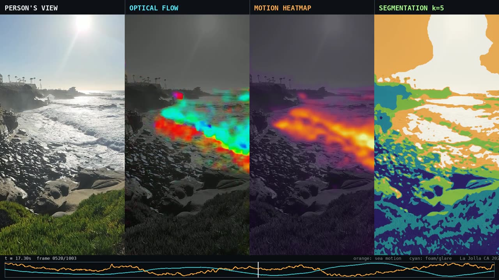

# tide-vision

Run a video through three classical computer vision views and compare them with the original footage.
Built for the Weird Signal post *Same Wave, Four Views: What a Machine Sees at High Tide*.

[](media/four_views_demo.mp4)

*Demo (720p, 33 s): [media/four_views_demo.mp4](media/four_views_demo.mp4). Footage: high tide, La Jolla CA, 2026-11-15.*

**Watch on YouTube**

- [High Tide, La Jolla: How a Person Sees It vs. How a Machine Does](https://www.youtube.com/watch?v=25XsUqsimOo) (side by side: original and optical flow view)
- [Same Wave, Four Views: High Tide at La Jolla Through Computer Vision](https://www.youtube.com/shorts/ToZP9ZID0FQ) (vertical Short, wipes through all four views)

| View | Method | What it shows |
| --- | --- | --- |
| Optical flow | Farneback dense flow, median flow subtracted (camera shake) | Direction (hue) and speed (opacity) of moving water |
| Motion heatmap | Decaying sum of flow magnitude, `E_t = 0.96 E_{t-1} + |v_t|` | Where motion has happened in the last ~0.8 s |
| Segmentation | k-means (k=5) in Lab, centroids fit on 5 frames then frozen | Five flat color regions, unlabeled |

A graph tracks mean sea motion and the share of pixels that look like foam or glare (low saturation, high brightness) below the horizon.

## Install

```bash
pip install -r requirements.txt
# ffmpeg must be on your PATH
```

## Run

```bash
python tide_vision.py input.mp4 --out-dir out --label "High tide, La Jolla CA"
```

Writes two files per input, with the original audio kept:

- `<name>_vertical.mp4`: 1080x1920, full frame, wipes through the four views (Shorts)
- `<name>_panels.mp4`: 1920x1080, four views side by side with the graph underneath

Options: `--layouts vertical panels`, `--horizon 0.31` (horizon height as a fraction of frame height; metrics ignore everything above it), `--crf 20`, `--max-frames N` for a quick test.

Input is expected to be 1080x1920 portrait. Other sizes are resized, and the panel crop assumes that aspect.

## Limits

- **Glare reads as foam.** The mask is a brightness threshold, so sun glitter counts too.
- **Segmentation uses color only.** Pale sky and whitewater land in the same cluster.
- **Flow needs texture.** It is weakest on smooth, glaring water.
- **Shake removal assumes a mostly static frame.**
- **Nothing is calibrated.** Thresholds were set by eye and there is no ground truth. Treat the numbers as a visual guide.

All tuning constants are at the top of `tide_vision.py`. Runtime is roughly 3 to 4 minutes for a 33 s, 30 fps clip on 2 CPU cores.

## License

MIT
